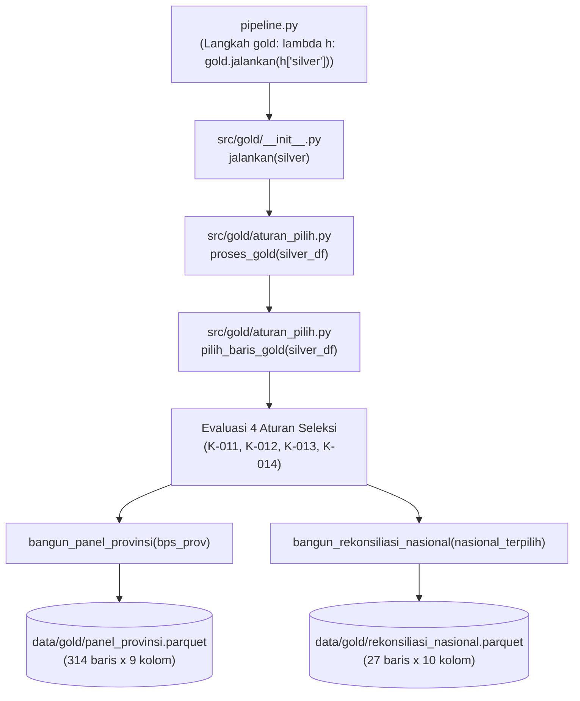

# Laporan Backlog #20: Aturan Satu Nilai per Sel Gold (Snapshot, Rincian Sebanding, dan Periode)

**Penyusun:** DAFFA KHARISMA ADZANA (124450061)  
**Komponen:** Profil dan Pembersihan / Persiapan Gold (Tahap 4)  
**Tugas Sampingan:** Penjaga Data & Evaluasi  
**Repositori:** Kelompok 1 — Capstone Data Wrangling  
**Tanggal:** 24 November 2026 (Sprint 2)  

---

## 1. Latar Belakang dan Tujuan
Pada lapisan *Silver*, data disimpan dengan prinsip inklusivitas silsilah data (*provenance integrity*). Silver diizinkan memuat lebih dari satu baris untuk sel wilayah dan periode yang sama, misalnya:
- Data dari snapshot waktu yang berbeda (revisi data resmi BPS/WDI).
- Berbagai rincian disagregasi demografis (pada data WHO GHO, satu tahun memiliki puluhan baris berdasarkan kombinasi gender, kelompok umur, dan derajat urban).

Namun, pada lapisan **Gold** yang dirancang sebagai tabel siap analisis panel ekonometrika/multivariat, aturan fundamentalnya adalah:
$$\textbf{Tepat satu nilai numerik per sel: } (\text{wilayah} \times \text{periode} \times \text{indikator})$$

Tujuan backlog ini adalah merancang dan mengimplementasikan fungsi otomatis di [src/gold/aturan_pilih.py](file:///C:/Users/daffascript_/workbench-workspace/capstone-data-wrangling/src/gold/aturan_pilih.py) yang secara deterministik memilih satu nilai yang sah, menyaring rincian yang sebanding, mempertahankan penanda anomali (*flags*), dan mencatat seluruh baris yang tidak terpilih ke [log-keputusan.csv](file:///C:/Users/daffascript_/workbench-workspace/capstone-data-wrangling/log-keputusan.csv) (ID `K-011`).

---

## 2. Alur Pemanggilan Fungsi dari Pipeline

Fungsi pemilihan baris Gold tidak dijalankan manual lewat notebook, melainkan terintegrasi utuh ke dalam rantai orkestrasi `pipeline.py`:



Rantai eksekusi kode:
1. `pipeline.py` (baris 23): memanggil `gold.jalankan(h["silver"])`.
2. [src/gold/\_\_init\_\_.py](file:///C:/Users/daffascript_/workbench-workspace/capstone-data-wrangling/src/gold/__init__.py) (`jalankan()`): menerima DataFrame Silver, mencetak log pemanggilan dan dampak baris, serta memanggil `proses_gold()`.
3. [src/gold/aturan_pilih.py](file:///C:/Users/daffascript_/workbench-workspace/capstone-data-wrangling/src/gold/aturan_pilih.py) (`proses_gold()`): memanggil `pilih_baris_gold()` untuk memilah observasi dan menghitung dampak baris per aturan keputusan.

---

## 3. Rincian Aturan Pemilihan Menuju Gold & Dampak Baris

Setiap aturan pencatatan terdaftar di [log-keputusan.csv](file:///C:/Users/daffascript_/workbench-workspace/capstone-data-wrangling/log-keputusan.csv) pada tahap `gold` dengan dampak baris yang dihitung secara spesifik:

| ID Keputusan | Aturan Seleksi | Logika & Implementasi | Seri Terdampak | Dampak Baris (Tidak Terpilih) |
|---|---|---|---|:---:|
| **K-011** | Deduplikasi Multi-Snapshot | Mempertahankan observasi snapshot terbaru (`keep='last'`) berdasarkan kunci 6-dimensi bila ada revisi data resmi | `var1473`, `var1474`, WDI, WHO | **0 baris** *(karena Silver sudah unik 6 dimensi)* |
| **K-012** | Rincian Sebanding WHO vs BPS/WDI | Hanya memilih rincian agregat total (`SEX=TOTAL` dan `TOTAL` murni) yang sebanding dengan seri BPS & WDI; subkelompok usia/gender tetap berada di Silver | `NUTSTUNTINGPREV`, `NUTOVERWEIGHTPREV`, `NUTRITION_WH_2` | **697 baris** *(50 stunting + 50 overweight + 597 wasting subkelompok)* |
| **K-013** | Integritas Periode Temporal | Wajib unit observasi tahunan murni (`jenis_periode == 'tahun'`); menolak agregasi/perataan buatan non-tahunan | Seluruh 7 seri Kasus 01 | **0 baris** *(seluruh 7 seri terverifikasi tahunan)* |
| **K-014** | Pembawaan Penanda Anomali | Membawa flag `is_outlier` dan `is_patahan` dari Sprint 1 ke panel Gold tanpa membuang baris data observasi | `var1473`, `var1474` (BPS) | **0 baris** *(tidak ada baris yang dihapus/dibuang)* |

### 3.1. Penjelasan Aturan Penanganan Multi-Snapshot (K-011)
Jika terdapat observasi dengan kombinasi kunci primer yang identik dari dua berkas snapshot yang berbeda:
- **Aturan:** Menggunakan prinsip *revisi resmi produsen data* (`drop_duplicates(subset=KUNCI_6, keep='last')`). Snapshot terbaru diperlakukan sebagai angka revisi mutakhir dari BPS/World Bank, sementara angka snapshot lama diarsipkan di Silver.

### 3.2. Penjelasan Aturan Penyaringan Rincian Sebanding (K-012)
Seri utama BPS (`var1473` dan `var1474`) diukur pada tingkat agregat seluruh penduduk provinsi (tanpa disagregasi gender balita). Agar perbandingan pada layer Gold valid dan adil (*apples-to-apples comparison*):
1. **Seri BPS (Provinsi & Nasional):** Hanya memilih baris dengan `rincian == 'Total'`.
2. **Seri WDI (Nasional):** Hanya memilih baris dengan `rincian == 'Total'`.
3. **Seri WHO GHO (Nasional):**
   - `NUTSTUNTINGPREV`: Hanya memilih rincian agregat total `SEX=TOTAL` (25 baris terpilih).
   - `NUTOVERWEIGHTPREV`: Hanya memilih rincian agregat total `SEX=TOTAL` (25 baris terpilih).
   - `NUTRITION_WH_2`: Hanya memilih rincian agregat total `TOTAL` murni (12 baris terpilih).
   - **Rincian Subkelompok yang Ditolak dari Gold:** Sebanyak **697 baris** Silver (50 baris stunting gender terpisah + 50 baris overweight gender terpisah + 597 baris wasting rincian umur/derajat urban) **TIDAK terpilih** masuk ke tabel Gold dan tetap dipertahankan aman di lapisan Silver.

### 3.3. Penjelasan Aturan Penanganan Periode Temporal (K-013)
- Seluruh 7 seri indikator pada Kasus 01 memiliki frekuensi pengukuran tahunan murni (`jenis_periode == 'tahun'`).
- Mengikuti keputusan `K-008`, pipeline menolak melakukan perataan paksa (*averaging/aggregating*) terhadap periode semesteran atau bulanan (jika ada data turunan di masa depan), guna mencegah bias estimasi dan menjaga keterlacakan data ke berkas mentah.

### 3.4. Penjelasan Aturan Pembawaan Penanda Anomali (K-014)
Sesuai hasil profiling Sprint 1, nilai ekstrem dan lonjakan data tidak dihapus melainkan diberi label diagnostik:
- Penanda anomali dari `reports/backlog/124450061/daftar_anomali_terklasifikasi.csv` disematkan langsung sebagai kolom metadata pada tabel panel Gold:
  - `status_anomali_var1473`: Kategori anomali indikator PoU (`NORMAL`, `OUTLIER_ASLI`, `PATAHAN_SERI`).
  - `status_anomali_var1474`: Kategori anomali indikator FIES (`NORMAL`, `OUTLIER_ASLI`, `PATAHAN_SERI`).
  - `is_outlier`: Boolean (`True` untuk nilai ekstrem geografis kepulauan Maluku & pegunungan Papua).
  - `is_patahan`: Boolean (`True` untuk fenomena pemekaran wilayah 4 DOB Papua tahun 2024–2025).

---

## 4. Struktur Tabel Keluaran Gold

Fungsi di [src/gold/aturan_pilih.py](file:///C:/Users/daffascript_/workbench-workspace/capstone-data-wrangling/src/gold/aturan_pilih.py) membentuk dua tabel Gold utama:

### 4.1. Tabel Panel Provinsi (`data/gold/panel_provinsi.parquet`)
- **Format:** Tabel lebar (*wide panel*), baris = $(\text{wilayah} \times \text{tahun})$.
- **Dimensi:** 314 baris $\times$ 9 kolom.
- **Daftar Kolom:**
  1. `wilayah_kode` (int): Kode provinsi BPS (1100–9700).
  2. `nama_wilayah` (string): Nama resmi 38 provinsi.
  3. `periode` (string): Tahun (2017–2025).
  4. `var1473` (float): Prevalensi Ketidakcukupan Konsumsi Pangan (PoU).
  5. `var1474` (float): Prevalensi Kerawanan Pangan Sedang/Berat (FIES).
  6. `status_anomali_var1473` (string): Keterangan anomali PoU.
  7. `status_anomali_var1474` (string): Keterangan anomali FIES.
  8. `is_outlier` (bool): Penanda nilai outlier asli.
  9. `is_patahan` (bool): Penanda patahan struktural DOB.

### 4.2. Tabel Rekonsiliasi Nasional (`data/gold/rekonsiliasi_nasional.parquet`)
- **Format:** Tabel komparasi makro tahunan antar-lembaga (BPS, World Bank, dan WHO).
- **Dimensi:** 27 baris (tahun 1996 s.d. 2025) $\times$ 10 kolom.
- **Indikator Berdampingan:**
  - `bps_var1473`, `bps_var1474`
  - `wdi_SN.ITK.DEFC.ZS`, `wdi_SN.ITK.MSFI.ZS`
  - `who_NUTSTUNTINGPREV`, `who_NUTOVERWEIGHTPREV`, `who_NUTRITION_WH_2`

---

## 5. Verifikasi dan Reproduksibilitas Pipeline

Implementasi ini terintegrasi penuh ke dalam [src/gold/\_\_init\_\_.py](file:///C:/Users/daffascript_/workbench-workspace/capstone-data-wrangling/src/gold/__init__.py) yang dipanggil langsung oleh `pipeline.py`. Saat perintah reproduksi dijalankan:
```bash
python pipeline.py
```
Output mencatat secara transparan setiap rantai pemanggilan dan dampak baris tiap aturan:
```text
======================================================================
[GOLD] Menjalankan Tahap 4 (Persiapan Gold) - Backlog #20
Alur Pemanggilan: pipeline.py -> src.gold.jalankan() -> src.gold.aturan_pilih.pilih_baris_gold()
----------------------------------------------------------------------
Pencatatan Dampak Baris per Aturan (tercatat di log-keputusan.csv):
  - [K-011] Multi-Snapshot Terbaru (keep='last')  : 0 baris
  - [K-012] Rincian Sebanding WHO vs BPS/WDI      : 697 baris
  - [K-013] Integritas Periode Tahunan            : 0 baris
  - [K-014] Penanda Outlier & Patahan Seri        : 0 baris
Total baris Silver yang tidak terpilih (sub-rincian tetap di Silver): 697 baris.
----------------------------------------------------------------------
Keluaran Gold berhasil disimpan:
  1. data/gold/panel_provinsi.parquet       : 314 baris x 9 kolom
  2. data/gold/rekonsiliasi_nasional.parquet : 27 baris x 10 kolom
======================================================================
```
Seluruh proses berjalan otomatis, deterministik, dan bebas dari modifikasi manual di notebook.
